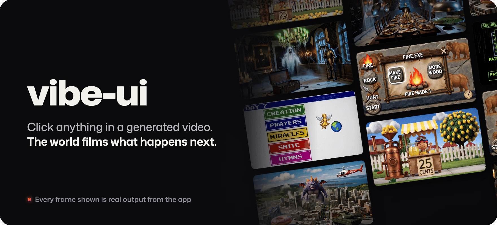

<p align="center">
  
</p>

<p align="center"><a href="https://vibe-ui.connerruhl.workers.dev"><b>Play it in your browser, no keys needed →</b></a></p>

vibe-ui turns a generated video into a world you can play. Click anything in the frame, or type an action, and [FastH3-Omni](https://docs.reactor.inc/model-api-reference/fast-h3-omni/overview), [Reactor](https://reactor.inc)'s realtime video model, films what happens next. A language model keeps the world's state and code writes the video prompt. Play a preset, or type a one-line idea and vibe-ui writes a new world.

<p align="center">
  
  <br>
  <sub>Three clicks, real app output.</sub>
</p>

## Play it

Open https://vibe-ui.connerruhl.workers.dev and choose a world. The hosted page holds the keys, so there is nothing to set up. `?preset=<id>` links straight to a world. **Make your own** writes a new world from a one-line idea, films its opening, and gives you a link anyone can open.

## Quick start

To play, open https://vibe-ui.connerruhl.workers.dev. To run it yourself, you need Node 22.6+, pnpm, and API keys for [Reactor](https://docs.reactor.inc) (FastH3-Omni), [OpenAI](https://platform.openai.com) (the world agent) and [TypeSafe](https://docs.typesafe.ai) (Jev, which finds what you can click).

```sh
pnpm install
pnpm dev
```

Open http://localhost:5317, choose **Use your own keys**, and pick a world. In dev, empty fields fill from `.env.local` (see `.env.example`).

Reactor sessions bill while open. **End** closes every session, and so does closing the tab.

## Hosted play and your own keys

- **Hosted play.** The Cloudflare Worker in `deploy/` holds the keys as secrets. The page calls it at `/api` and never sees a key. The Worker mints a short-lived Reactor token for each session, streams the agent's calls, forwards Jev and picture requests, and stores shared worlds. It answers only the site's own origin, under per-visitor rate limits, size caps and model allowlists. A visitor holds at most two Reactor sessions and the site five, each ended after ten minutes. One deploy-time switch turns hosted play off.
- **Your own keys.** **Use your own keys** at the foot of the world picker (or `?keys=1`) saves your keys in this browser and sends each call straight to its provider. Jev's calls go through the page's `/jev` route, because TypeSafe rejects browser origins; the dev server proxies it locally and the Worker forwards it when hosted.

To deploy your own copy, see `pnpm ship --help`.

## How it works

1. You click a box Jev found on the current frame, or you type.
2. The agent replies with a few one-line ops (`src/agent/lines.md`): `+id` adds a thing, `-id` removes one, `~id` changes how it looks, `!` is a burst of motion.
3. Code applies them to the world, a small tree of things, places and facts (`src/state`), and sends any change it can't use back to the agent.
4. The projector (`src/projector`) turns the world and the change into an Omni prompt. The same world and change always give the same prompt.
5. Omni films the clip on a pool of five warm sessions (`src/pool`). Every clip ends at rest, so its last frame is still.
6. Jev boxes the last frame (`src/jev`). Those boxes are what you click next (`src/boxes`).

While you look at a frame, the agent guesses your next clicks and writes its answers. Spare sessions film each one and box its last frame before you click (`src/moments`). A correct guess plays at once from local media; a miss is filmed live.

Presets play from a baked tree of moments, keyed by content. That media stays out of git. `pnpm bake --all` films it with your keys and ffmpeg; until then, presets play live.

Press backtick, or add `?debug=1` to the URL, to see the boxes and the debug panel.

## Worlds

Each folder in `src/presets/` is a world. No code names a preset; a test enforces it.

- `premise.md`: the world in prose, read by the agent every turn
- `world.json`: the starting world and its canon, the rules for how it's filmed
- `busy.md` and `busy/`: what plays while an answer is coming
- `moments/`: the baked tree

A world written from an idea is saved in your browser. **Copy link** stores its text (premise, world and busy state, nothing else) on the Worker for 180 days so the link opens anywhere. To keep it in the repo, click **Export** on its card and drop the folder into `src/presets/<id>/`. `src/scenario/write.md` covers every field.

## Tooling

Every script documents itself with `--help`. The scripts drive the app in Playwright's Chromium; install it once with `pnpm exec playwright install chromium --no-shell`. `pnpm eval` runs scripted sessions; with mocked Omni and Jev, the default, only the world agent's OpenAI calls cost anything. `pnpm check` is the full gate and needs no keys; see [CONTRIBUTING.md](CONTRIBUTING.md).

## Speed

Measured with real Omni and Jev across eight presets:

| Moment                              | Time to first frame |
| ----------------------------------- | ------------------- |
| Baked opening                       | 0.17 to 0.22 s      |
| Guessed click, captured and boxed   | 0.02 to 0.1 s       |
| Guessed click, filmed, not captured | 0.35 to 0.55 s      |
| Miss                                | 6.5 to 7.2 s        |

A miss plays the world's busy state while it films. A clip that moves to a new place can cut visibly from the frame it started on.

## Built on

- [FastH3-Omni](https://docs.reactor.inc/model-api-reference/fast-h3-omni/overview) by [Reactor](https://reactor.inc), through [`@reactor-team/js-sdk`](https://www.npmjs.com/package/@reactor-team/js-sdk)
- [Jev](https://docs.typesafe.ai) by [TypeSafe](https://typesafe.ai)
- [OpenAI](https://platform.openai.com) models for the world agent

Preset worlds are parodies; named products and styles belong to their owners.

## License

[MIT](LICENSE) © Conner Ruhl.
